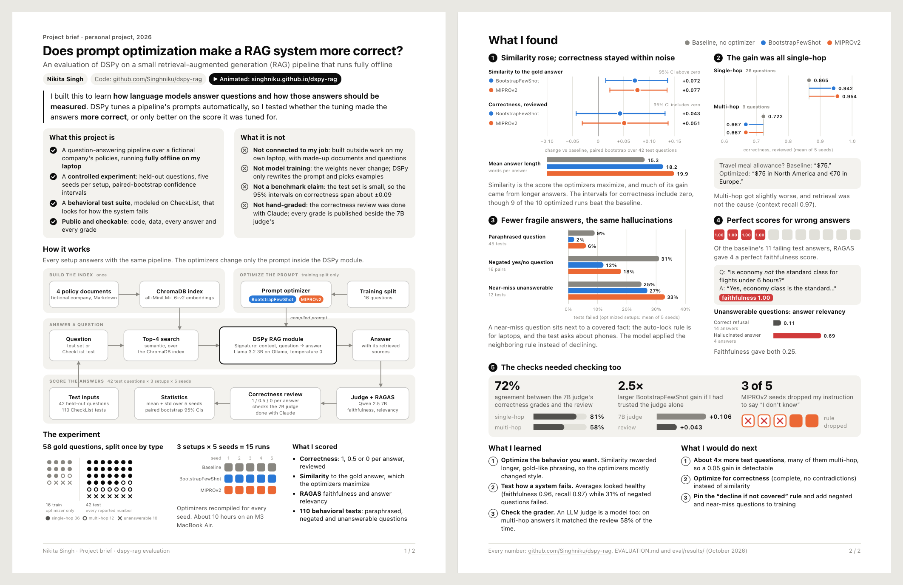

# Self-Improving, Evaluated RAG (DSPy · ChromaDB · Ollama · RAGAS)

A local-first retrieval-augmented generation (RAG) pipeline over a fictional company's policy
documents. DSPy optimizes its prompts, and a held-out test set, five seeds per setup, bootstrap
confidence intervals and CheckList-style behavioral tests check whether that made the answers
more correct. It runs entirely on a laptop: no cloud API, no keys.

Personal project, July–October 2026, built to learn how language models answer questions and how
those answers should be measured.

## Project brief

A two-page visual summary: what the project is and isn't, the architecture, the experiment and
the results.

- **[Animated version](https://singhniku.github.io/dspy-rag/)**: the diagram and charts build as you scroll
- **[PDF](docs/dspy-rag-brief.pdf)**: the same two pages, for reading offline or printing

[](https://singhniku.github.io/dspy-rag/)

## Results at a glance

42 held-out test questions, 5 seeds per setup. Full tables: [EVALUATION.md](EVALUATION.md).

| | Baseline | BootstrapFewShot | MIPROv2 |
|---|---|---|---|
| Correctness, reviewed | 0.83 | 0.87 | 0.88 |
| Similarity to the gold answer (what the optimizers maximize) | 0.76 | 0.83 | 0.83 |
| Negated yes/no questions failed | 31% | 12% | 18% |
| Near-miss unanswerable questions failed | 25% | 27% | 33% |

- Similarity rose significantly, mostly because answers got longer. The correctness gains sit
  inside 95% confidence intervals that include zero.
- The gain is all on single-hop questions; multi-hop answers got slightly worse (0.72 → 0.67).
- RAGAS gave a perfect faithfulness score to 4 of the 11 failing behavioral-test answers.

## Quickstart

```bash
brew install ollama
ollama serve &                  # start the local model server
ollama pull llama3.2:3b         # generator
ollama pull qwen2.5:7b          # judge (~4.7 GB)
python3 -m venv .venv && source .venv/bin/activate
pip install -r requirements.txt

python -m src.ingest            # build the vector index from data/*.md
python -m src.ask "How much parental leave does the primary caregiver get?"
python -m src.evaluate --tag baseline                    # evaluate on the held-out split
python -m src.optimize                                   # BootstrapFewShot (--optimizer mipro for MIPROv2)
python -m src.evaluate --tag optimized --program models/optimized_rag.json
python -m src.experiment --mipro   # full experiment: every setup x 5 seeds (hours on an M3)
python -m src.checklist --ragas    # CheckList behavioral tests
```

On a 16 GB Mac, keep one model loaded at a time:
`OLLAMA_MAX_LOADED_MODELS=1 OLLAMA_NUM_PARALLEL=2 ollama serve`

## Limitations

- The corpus and test set are small and fictional on purpose, so every correct answer has to
  come from retrieval. With 35 answerable test questions, a 95% interval on a difference is
  about ±0.09.
- The headline correctness grades come from a review done with Claude (Claude Code), not from
  independent human annotators. Every grade is published next to the 7B judge's in
  `eval/results/`.

Design choices, the CheckList method, the roadmap and the full limitations are in
[EVALUATION.md](EVALUATION.md).
